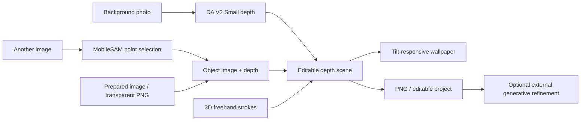

# DepthSketch

### Lightweight, Editable 3D Wallpapers

Turn a photo into a depth-aware scene, collage objects from other images, and draw in 3D — directly on an Android phone. Arrange foreground and background layers with real depth occlusion, then bring the scene to your home screen as a tilt-responsive live wallpaper.

**On-device inference · No API keys · Offline editing · Editable scenes**

[Download Android APK](https://github.com/JadeJiang04/DepthSketch/releases/latest) · [中文说明](docs/zh-CN/README.md) · [Build from source](docs/BUILDING.md)

## Try it

1. Download `DepthSketch-0.3.3-android.apk` from [Releases](https://github.com/JadeJiang04/DepthSketch/releases/latest) and install it on an **Android 8.0+** phone.
2. Import a background photo with **＋ 图片**. Depth Anything V2 Small estimates its depth locally.
3. Open **⋯ → 从新图片点选抠图** to select an object from another image, or **直接导入图片素材** to add an already prepared image, including transparent PNGs.
4. Move, scale and rotate objects, adjust their depth, and add freehand strokes. Choose **预览重力动态壁纸** to preview the scene and open Android's wallpaper confirmation screen.

The current app interface is in Chinese; the labels above match the APK. This is an experimental, directly installable preview build. The APK bundles its models and is approximately **216 MiB**, so the first run needs no model download. “Lightweight” describes the small models and native, cached rendering pipeline; it does not mean a tiny download.

## What you can make

| Feature | How it works |
| --- | --- |
| Photo to depth scene | DA V2 Small estimates relative depth; OpenGL renders the image as a textured 2.5D mesh. |
| Object collage | MobileSAM extracts an object from another image using positive/negative point prompts. Its image and depth are cropped together, ready for placement in the scene. |
| Prepared image materials | Import a transparent PNG or an opaque image directly, skipping segmentation. Preserve alpha, semitransparent edges and disconnected details. Opaque images remain whole rectangles. |
| 3D drawing | Each freehand stroke is a separate object. Draw along the photo surface or on a floating depth plane; edit position and X/Y/Z rotation afterward. |
| Foreground/background staging | Change layer depth and object relief to arrange occlusion, scale and composition. Edge feathering helps blend pasted objects. |
| Editable projects | Undo/redo, duplicate/delete objects, export PNGs, and save/reopen `.dsketch` projects. |
| Live wallpaper | Tilt-driven parallax with damping and adjustable framing. Wallpaper playback uses a saved scene and runs no neural models. |
| Composite depth experiment | Flatten the current collage and re-estimate its depth in a separate preview. Keep the original layered project for further editing. |

The goal is a hands-on **scene-staging experience with foreground/background occlusion**. It works with general photographs and artwork; it is not restricted to anime or any particular subject.

## Local by design

The core workflow makes **zero inference API calls**. There are no API keys, accounts, cloud inference services or Huawei-specific dependencies, and the app declares no Internet permission. Depth estimation and segmentation use **ONNX Runtime on the phone's CPU** during image preparation. Editing reuses cached depth and GPU geometry; the wallpaper pauses rendering and sensors when it is not visible.

Small models and cached results keep repeated editing responsive. Image preparation time varies by phone, resolution and content; this project does not promise real-time inference on every device.

## Optional generative post-processing

Export a PNG and use it as a composition reference for an external multimodal or image-editing model to refine lighting, color, edges or details. This is an **optional workflow after export**, not an integrated API feature. External services have their own costs and privacy terms. A refined flat image does not preserve the original editable objects; it can be imported again and given a new depth estimate.

## Under the hood

- Native Android **Java + OpenGL ES 2.0 + ONNX Runtime**; minimum Android API 26.
- **Depth Anything V2 Small** for relative depth and **MobileSAM** for interactive segmentation.
- CPU inference for broad compatibility; ARM64, ARMv7 and x86_64 are included in the preview APK.
- Depth input uses a mobile working resolution: target short edge 280, long edge at most 504, aligned to multiples of 14. It is not the official full-resolution accuracy benchmark.
- Source images are limited to a 1536-pixel long edge; the depth mesh uses at most 240 vertices along its longer axis.

Single-image depth produces **2.5D visible surfaces**, not a complete 3D reconstruction. Large rotations can stretch surfaces or expose missing background. Depth is relative, not a metric distance measurement. Segmentation quality depends on the image and prompts; extra foreground/background points can help. Automatic relighting and hidden-background reconstruction are not implemented.

## Development and verification

See [building instructions](docs/BUILDING.md), [device integration checks](docs/TESTING.md), and [v0.3.3 verification evidence](docs/releases/v0.3.3/verification.json). The source includes real-model checks for drawing, transforms, segmentation, alpha preservation, project round trips and Android live wallpaper integration.

Model weights and generated APKs are kept out of Git history. Download scripts use pinned revisions and SHA-256 checks; the ready-to-install APK is distributed through GitHub Releases.

## Credits and license

Thanks to [Depth Anything V2](https://github.com/DepthAnything/Depth-Anything-V2), [MobileSAM](https://github.com/ChaoningZhang/MobileSAM), the [ONNX community DA export](https://huggingface.co/onnx-community/depth-anything-v2-small), [Acly's MobileSAM exports](https://huggingface.co/Acly/MobileSAM), and [ONNX Runtime](https://github.com/microsoft/onnxruntime).

Original application code: [MIT](LICENSE). Models, exports and dependencies retain their upstream licenses; see [third-party notices](THIRD_PARTY_NOTICES.md).
